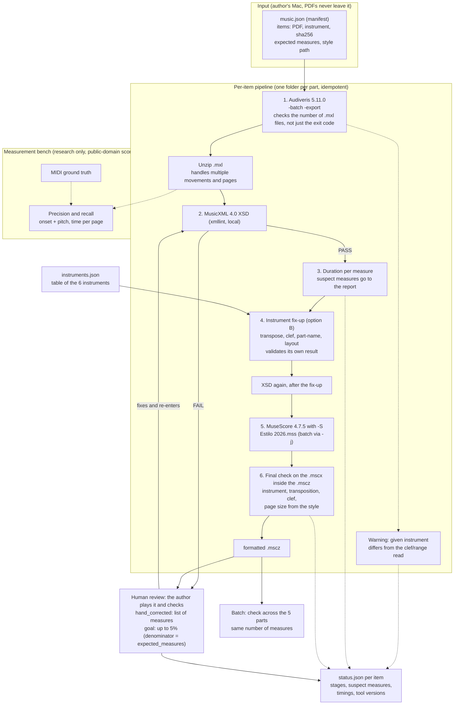

# omr-ingestor architecture

Planned flow. The diagram is **inferred**: only stage 5 (`-S`) has been tested; the rest has not run. Source: OMR study (v4, 2026-11-04).

## Stages

1. **Audiveris.** Runs `-batch -export` on the PDF. Checks the number of `.mxl` files produced, not just the exit code. Unzips and handles multiple movements.
2. **XSD.** Validates the MusicXML against the local 4.0 XSD (xmllint). On failure, it goes to human review.
3. **Duration per measure.** Lists measures that do not add up in `status.json`.
4. **Instrument fix-up.** Applies `instruments.json` to the given instrument: `<transpose>`, clef, name, sound; removes the OMR page layout. Adds a rehearsal mark on suspect measures. Runs the XSD again.
5. **MuseScore.** Converts to `.mscz` with `-S "Estilo 2026.mss"`.
6. **Final check on the `.mscx`.** Opens the `.mscz`, reads the `.mscx` and checks instrument, transposition, clef and the style's page size.

After that: human review (the author plays and corrects), re-entry through the XSD, and, in batch mode, a check that all parts have the same number of measures.

## Decisions already made

- The instrument is given at submission time, one of the 6 ids in `instruments.json`; the pipeline does not guess it from the PDF. Provided by the author (2026-11-03).
- Acceptance criterion: up to 5% of the measures corrected by hand per part; denominator = `expected_measures`. Provided (2026-11-03).
- A measure whose duration does not add up becomes a rehearsal mark in the `.mscz` and the flow continues; the list goes in `status.json`. Provided (2026-11-04). Whether the mark survives `-S` is a guess, untested.
- `-S` with validated MusicXML on MuseScore 4.7.5 on 2026-11-04: the style in the `.mscz` is identical to Estilo 2026 (diff 0, A5 landscape). Measured, 1 file with 2 parts.
- The final check on the `.mscx` is mandatory because the `mscore` exit code is not reliable (it exited 134 with the file generated). Measured (2026-11-04).
- Runs on the author's Mac; PDFs never leave it. Provided (2026-11-03).
