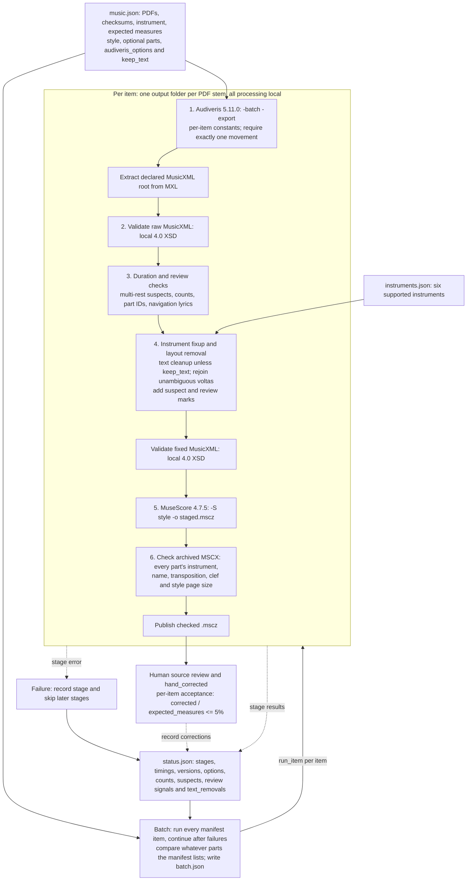

# omr-ingestor architecture

All six stages are implemented on main for a single manifest item (`run`) and for
all items (`batch`). Stage 4 groups fixup and its XSD check, which status records
as separate stages, giving seven stage names. Automated tests exercise the
pipeline with fake Audiveris and MuseScore executables. Real-tool observations
below are bounded measurements, not a claim that every converted score is
musically correct.

## Stages

1. **Audiveris.** Runs `-batch -export` with the item's `audiveris_options` as
   separate `-option name=value` arguments. Checks the exported `.mxl` files,
   extracts each archive's declared MusicXML root, and requires exactly one
   movement per PDF. Multiple score parts in that movement are supported;
   multiple movements are rejected. An exit code alone does not decide success.
2. **XSD.** Validates the raw MusicXML against the local MusicXML 4.0 XSD using
   `xmllint`. A failed stage stops the item and skips subsequent stages.
3. **Duration and review checks.** Checks per-measure duration. A short first
   measure is accepted as a pickup only with `implicit="yes"` or a short last
   measure under the same time signature whose duration completes the bar with
   it. Otherwise it remains a duration suspect. Supported implicit/split bars
   remain accepted. A `<multiple-rest>` start is suspect even
   when its duration adds up; missing rest content is not reconstructed. Records
   each part's measure count against `expected_measures`. Independently records
   `measure_count_mismatch`, `part_count_mismatch`, `part_identity` and
   `navigation_lyric` review signals from the raw export. Unsafe part IDs fail
   this stage after the signal is saved, before fixup can transform an ambiguous
   part. `measure_count_mismatch` and `navigation_lyric` warnings alone do not
   fail conversion. A `part_count_mismatch` is recorded here, but an incompatible
   number of parts fails the later fixup stage.
4. **Fixup and XSD again.** Requires one part or exactly the count in the item's
   `parts` list, with one staff per part. Applies instrument metadata, clef,
   transposition, sound and configured display names without changing pitches.
   Removes OMR page layout and rejoins the supported unambiguous split-volta
   pattern. A rewrite gets a `?` mark and a fixup stage detail, but does not by
   itself set `review_required`. Ambiguous endings enter `suspect_measures` and
   set `review_required`. By default it strips recognized text, preserving
   navigation directions and musical notation;
   `keep_text: true` disables text removal for the item. Cleanup runs once across
   all parts before adding `?` rehearsal marks and `Review: ...` annotations.
   Validates the resulting MusicXML against the XSD again.
5. **MuseScore.** Converts the fixed MusicXML with `-S` and `-o` into a staged
   `.mscz` using the manifest's style, normally Estilo 2026. Validates the output
   archive instead of relying on the process exit code.
6. **Final check.** Opens the `.mscx` inside the `.mscz` and checks every part's
   name, instrument, transposition and clef, plus the page size from the style.
   Publishes the staged file only after these checks pass. A rejected archive is
   retained for inspection; an earlier successful output is not replaced by it.

## Status, batch and human review

Each item writes `output/<pdf stem>/status.json` atomically after stage updates.
It records stage outcomes, timings, tool versions, effective Audiveris options,
`measure_count` (`read`, `expected`, `missing`), suspects and human corrections.
When configured parts have different counts, `measure_count` is `null`; per-part
counts remain in the stage detail, and batch reports the item as `not_counted`.

[PR #27](https://github.com/faelplg/omr-ingestor/pull/27) introduced status schema 4:
`review_signals` carry `code`, `detail`, `part_id` and `measure`, and
`review_required` is true for review signals or duration/volta suspects. Part
identity checks cover unique IDs and their declarations, not musical continuity
or swapped voices. Navigation-like lyrics are review hints, including false
positives for ordinary words. Count warnings are anchored at the part's first
measure and cannot locate missing content. See the [README review signals](../README.md#review-signals)
for the precise behavior and score annotations.

[PR #29](https://github.com/faelplg/omr-ingestor/pull/29) advances current status to
schema 5 with `text_removals`: element counts for credits, headers, lyrics, words,
rehearsals and text-like technical marks. Counts are zero with `keep_text: true`,
and unknown (`null`) before fixup completes or when reading schemas 1-4. Schemas
1-3 load with no review signals; only a rerun performs the new checks.

Batch runs all items in manifest order and continues after item failures,
including per-item setup and I/O failures. It compares whatever parts the
manifest lists, using available shared counts and each item's expected count.
`batch.json` schema 3 contains item outcomes, review state and cross-part
agreement. Count disagreements are warnings; batch exits successfully only when
all items pass their stages.

Human review compares the output with the PDF and records `hand_corrected`.
The acceptance ratio is computed **per item** as the number of entries in its
shared `hand_corrected` list divided by `expected_measures`, with a **<=5%**
limit. It is a per-part ratio only for single-part items. Multipart items share
one list and cannot record the same measure number separately for each part.
Before review, acceptance is unknown. This human metric is separate from stage
success and does not clear review warnings. See [Known accuracy limits](accuracy.md)
for detection gaps and input-specific recognition settings. Rerunning recomputes
from the PDF and preserves the recorded human correction list; there is no automatic re-entry command for an edited MusicXML.

## Decisions and measured evidence

- Instrument selection is explicit, never inferred from the PDF. The six IDs are
  `bb-trumpet`, `trombone`, `flute`, `alto-saxophone`, `tenor-saxophone` and `tuba`.
  The catalog size does not constrain how many parts a manifest lists.
- The pipeline is local to the author's Mac. Copyrighted PDFs and derived score
  material stay off the repository and are not sent to another machine.
- Real MuseScore 4.7.5 testing on 2026-11-04 found Estilo 2026 applied with zero
  style diff on one two-part file (A5 landscape). A generated file survived exit
  code 134, motivating output validation and the mandatory final MSCX check.
- Volta repair is deliberately narrow: an ending split into consecutive spans
  before a backward repeat is rejoined only when the supported pattern is
  unambiguous. Other suspicious endings remain for human review. Automated tests
  cover the rewrite and marks; they do not establish source fidelity for every
  ending or prove every mark survives every real-tool conversion.
- Multi-measure rests and missing/extra measure counts require review even if
  surviving bars total correctly. Neither signal reconstructs lost content.
- Per-item Audiveris constants preserve installed defaults when omitted and are
  recorded in logs and status. On the framed Carnaval test set, reducing
  `StaffProjector.staffAbscissaMargin` to `1.0` separated false system connections;
  four parts reached 33/33 measures, with one remaining trombone duration suspect.
  The tenor also needed 600 dpi. These are layout-specific settings, not global
  defaults.
- Successful stage checks establish structural properties, instrument metadata
  and style checks. Musical accuracy still depends on source-backed human review
  and the <=5% per-item hand-correction ratio described above.
