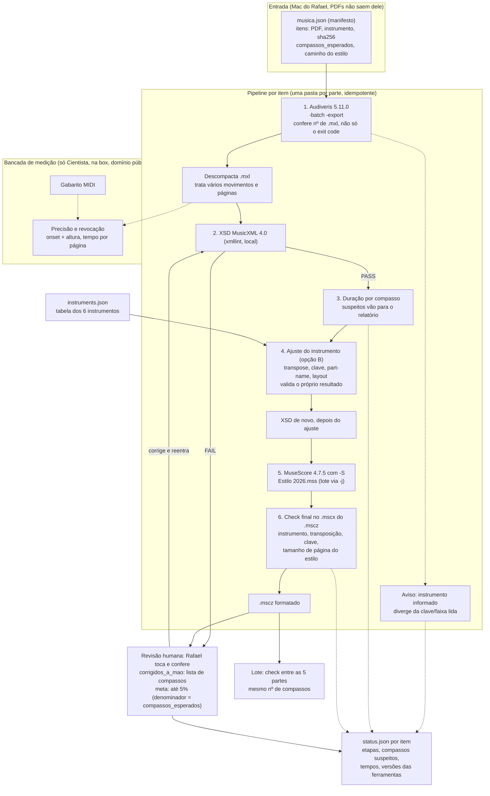

# Arquitetura do omr-ingestor

Fluxo planejado. Diagrama **inferido**: só a etapa 5 (`-S`) foi testada; o resto não rodou. Fonte: estudo OMR (v4, 04/11/2026).

## Etapas

1. **Audiveris.** Roda `-batch -export` no PDF. Confere o número de `.mxl` gerados, não só o exit code. Descompacta e trata vários movimentos.
2. **XSD.** Valida o MusicXML contra o XSD 4.0 local (xmllint). Falhou, vai para revisão humana.
3. **Duração por compasso.** Lista compassos que não fecham no `status.json`.
4. **Ajuste do instrumento.** Aplica `instruments.json` ao instrumento informado: `<transpose>`, clave, nome, som; apaga layout de página do OMR. Marca de ensaio nos compassos suspeitos. Roda XSD de novo.
5. **MuseScore.** Converte para `.mscz` com `-S "Estilo 2026.mss"`.
6. **Check final no `.mscx`.** Abre o `.mscz`, lê o `.mscx` e confere instrumento, transposição, clave e tamanho de página do estilo.

Depois: revisão humana (Rafael toca e corrige), reentrada pelo XSD, e em lote o check de mesmo número de compassos entre as partes.

## Decisões já tomadas

- Instrumento é informado no envio, um dos 6 ids de `instruments.json`; o pipeline não adivinha pelo PDF — informado (Rafael, 03/11/2026).
- Critério de aceite: até 5% dos compassos corrigidos à mão por parte; denominador = `compassos_esperados` — informado (03/11/2026).
- Compasso cuja duração não fecha vira marca de ensaio no `.mscz` e o fluxo segue; a lista vai no `status.json` — informado (04/11/2026). Se a marca sobrevive ao `-S`: palpite, não testado.
- `-S` com MusicXML validado no MuseScore 4.7.5 em 04/11/2026: estilo no `.mscz` idêntico ao Estilo 2026 (diff 0, A5 paisagem) — medido, 1 arquivo com 2 partes.
- Check final no `.mscx` é obrigatório porque o exit code do `mscore` não é confiável (saiu 134 com arquivo gerado) — medido (04/11/2026).
- Roda no Mac do Rafael; PDFs não saem de lá — informado (03/11/2026).
